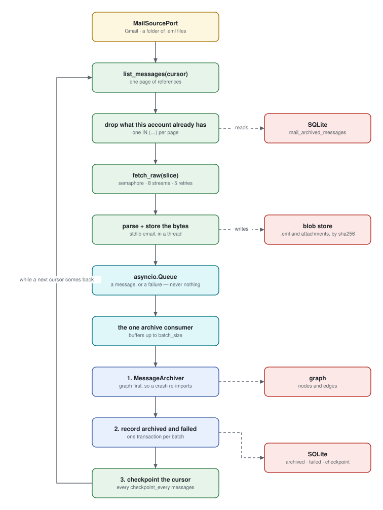
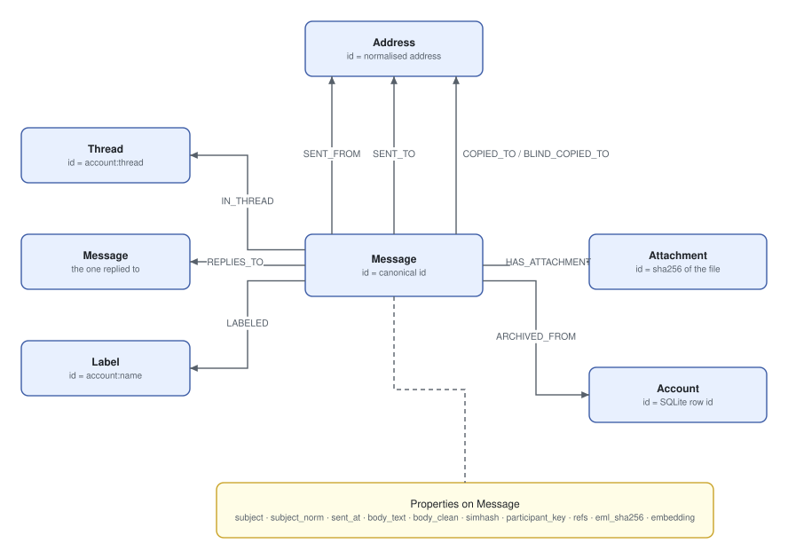

# Importing mail

## What an import does

It walks the mailbox one page at a time. For every message it has not seen
before it fetches the original RFC 5322 bytes, writes those bytes to disk under
their sha256, parses them, and writes the result into the graph.



The first import of a large mailbox is tens of thousands of HTTP requests and
takes hours. It is built to survive that: the laptop lid can close, the process
can be killed, the provider can rate-limit — and the next run picks up where the
last one stopped.

## Starting one

An import is a **job**. Something enqueues it, a worker claims it, and the job
row is what you watch.

There are three ways one gets enqueued:

- **Sync**, the circular arrow at the top of the icon rail, on every page. One
  press asks every enabled mailbox for whatever it has not archived yet. The
  arrow spins for as long as anything is still running — including a job you
  started somewhere else, or one the schedule queued while you were away — so
  the rail says whether mail is arriving without your having to open a page.
- **Import** on a single mailbox's page in **Mail accounts**, when you want one
  mailbox rather than all of them.
- The **interval schedule**, which queues deltas on its own once a mailbox has
  had its first full import (see [Configuration](./configuration.md)).

### What one press of Sync does

Per mailbox, and it is not the same answer for each:

| The mailbox | What it gets |
| --- | --- |
| Already imported once | An `incremental` — only what changed since the last run |
| Never imported, or a provider with no delta | A full `import`. Already-archived messages are skipped, so this is not a re-download |
| Already running a job | Nothing. Two runs over one mailbox collide on the archive's unique key |
| Waiting for a re-consent, or naming a provider this build does not have | Nothing, and it is counted as needing attention |
| Disabled | Nothing, and it is not counted at all |

A press says what it did twice, in a message that appears in the top right
corner and fades after three seconds:

- **When you press it.** How many mailboxes are now syncing, plus whatever else
  the press ran into — mailboxes that were already going, and mailboxes waiting
  for you on the accounts page. A press that started nothing says why, which
  includes an archive with no mailboxes in it yet.
- **When the run ends.** How much mail it brought in: `Finished: synced 57
  messages.` If any messages could not be archived the count says so and the
  message is amber rather than green. Only the mailboxes *that press* started
  are counted, so a job the schedule was already running is not folded into
  your number.

The second one arrives whichever page you are on by then, since a sync outlasts
the page it was started from. It does not arrive if you close the window: there
is nothing to show it on, and the count is still in the job's row on the
mailbox's page.

The same sentences are in the tooltip, which is where they stay after the
message has faded: hover the button and it tells you what is happening now, or
what the last press did.

This is the same decision the interval schedule makes, with one deliberate
difference: the schedule leaves a never-imported mailbox alone, because a delta
over one has no history to start from. Sync does not, because you asked.

The worker runs as a child of the web application by default. Where you want it
on its own — under Docker, systemd, or just to watch its log:

```sh
task sync:worker
```

Set `sync.supervise_worker: false` in that case, or the application starts a
second one and the two race for the same jobs.

## Reading the progress

A job carries four numbers, and they are deliberately not collapsed into one:

| Number | Meaning |
| --- | --- |
| `listed` | The provider offered this message |
| `skipped` | We already had it — no fetch, no write |
| `archived` | It reached the graph |
| `failed` | It did not, and there is a row saying why |

The progress bar counts `archived + skipped` as done, because that is how much
of the mailbox has been dealt with. `failed` is tracked separately on purpose:
folding it into "archived" would make a broken mailbox look like a small one.

`estimated_total` is the provider's own guess. It is allowed to be wrong, and on
Gmail it usually is by a little.

## Cancelling

A job is **asked** to stop, never killed. The request is read between two
batches, so a cancel takes effect once the batch in flight has been written —
typically within a page. Nothing is left half-written, and the checkpoint is
current, so resuming continues from there.

## Resuming, and what a crash costs

Two mechanisms, doing different jobs.

**The checkpoint** stores the provider's cursor every ~200 messages. A crash
costs at most that many messages of *listing* work.

**The archived-message ledger** remembers every provider id already written. So
even the messages between the last checkpoint and the crash are not re-fetched
— the next run lists them, recognises them, and skips them.

The two orders in the write path are chosen for this:

- The graph is written **before** the ledger. A crash between them leaves a
  message archived but not noted, so the next run archives it again — which is
  free, because the writer is idempotent. The other order would lose the message
  for good.
- The checkpoint advances **after** everything before it is archived. It never
  points past work that did not land.

## Importing the same mailbox twice

Costs one listing pass and writes nothing.

A message's identity comes from the message, not from the provider: its RFC 5322
`Message-ID` where there is one, and a content hash over
`sent_at | from | subject | sha256(body)` where the sender omitted it. So the
same mail arriving through two of your accounts is **one** `Message` node with
two `ARCHIVED_FROM` edges — not two copies.

The same holds for everything the message points at. One `Address` node per
address, one `Attachment` node per file content (twenty messages carrying the
same PDF share one node, and the filename hangs on the edge, because senders
rename things).

## Clearing a mailbox

**Clear** on the accounts page deletes everything a mailbox has imported and
leaves the mailbox itself alone. It is the way to import an account again from
the beginning — after a provider was set up wrongly, after a folder filter
changed, or when the archive for that account is simply not what you wanted.

It is not **Delete**. The mailbox keeps its name, its address and the
credential that opens it, and it stays in the list; only its mail goes. Press
**Import** afterwards and the full walk starts from nothing, because clearing
also forgets the two things that would otherwise make a second import a no-op:

* the ledger of provider ids this account has already archived — the table the
  import subtracts from every listing batch *before* it fetches anything, so an
  archive emptied without it re-imports nothing at all and reports success;
* the sync checkpoints, both the full walk's page token and the incremental
  watermark.

The dialog asks first, and it names the mailbox it is about to empty.

### Mail two mailboxes hold stays

The section above says the same mail arriving through two of your accounts is
one `Message` node with two `ARCHIVED_FROM` edges. Clearing one of those
accounts takes its edge and **not** the message: the other account's copy is
still mail you have, and it stays readable with its sender and its
attachments. The count that comes back after a clear-out says how many such
messages stayed, and it is worth reading — a mailbox that reports several
thousand and clears three is a mailbox where something else is wrong.

### What is not deleted

`Address` nodes survive, which is what keeps "always show pictures from this
sender" alive across a re-import — that decision is about the address, not
about which mailbox the mail arrived in. The original bytes stay in the blob
store as well: it is content-addressed and write-once, so a re-imported message
finds its own blob already there, and proving that no other message references
the same bytes is not something worth getting wrong.

**Tags survive too.** A tag is your name for a set of messages, not something
the mailbox contained, so clearing the mailbox does not take it. The
memberships go with the messages they were on — a tag whose mail was only in
this mailbox comes back with a count of zero — and the tag itself stays in the
list until you delete it. Re-import the mailbox and the tag is still there,
ready to be filled again.

The derived layer (groups, topics, circles, templates and the importance
scores) is disposable by construction:
whatever hung off a deleted message goes with it, and the next **Rebuild** on
the insights page recomputes the rest.

### While an import is running

Clearing is refused while a job is running *or queued* against that mailbox,
and the page says so. A queued import starts the moment a worker frees up,
which mid clear-out would leave a graph and a ledger that disagree. Let it
finish, or cancel it, then clear.

## When a message is skipped

Some messages will not parse — broken MIME, a truncated multipart, a 404 from
the provider. Those are skipped, and **every skip leaves a row** in
`mail_failed_messages` with the provider's id, a reason and the detail.

There is no silent failure anywhere in the import. A skipped message is a
countable event, not a gap.

## When the provider pushes back

A rate limit or a 5xx is treated as "the same call may work". The engine backs
off exponentially — 1s, 2s, 4s, … capped at 60s, with jitter added upward so a
hundred slices that failed together do not all return at the same instant. If
the provider sent a `Retry-After`, that is a floor the engine will not undercut.

After five attempts on the same slice, the engine gives up. That is not a
hiccup, it is an outage, and a run that waits it out would hold a lease it
cannot honour. The job fails, goes back in the queue, and a later run resumes at
the checkpoint.

An **authentication** failure is different: it ends the job immediately and puts
the account into `auth_error`. Retrying a revoked token never works.

## What the graph ends up holding



Everything in the solid boxes is read out of the message or computed from it
deterministically, so re-parsing the same bytes gives the same node. Nothing is
guessed.

The two dashed frames are written later and by somebody else. `Tag` is what you
file mail under by hand, and `Community` is one of the groupings an analysis
works out. See [Insights](./insights.md) for both.

The graph keeps a capped rendering of the body — 64 KB by default, enough for
full-text search. The whole message stays in the blob store, so a longer body is
never lost, only unindexed past that point. A parser fix can be replayed over
the entire archive from those bytes without asking the provider for anything
twice.

## Looking at what arrived

**Search** — the page the window opens on, at `/` — is where you look at what
arrived. Opened with no question in it, it lists the whole archive newest
first, which is what you want right after an import; filling in a sender, a
recipient, a date range, a kind of attached file or the words in a message
narrows that list. Under a row's preview sit the labels the provider filed the
message under — your own
labels in blue, folders in teal, the provider's housekeeping (Inbox, Updates,
Unread) in grey and last. Pick a message and the reading pane beside the list
shows it in two tabs:

- **Message** — the way a mail client renders it, in a mail client's order:
  the subject on top, under it the sender's name with their address after it
  and the date opposite, then the `To:` and `Cc:` lines, then chips naming
  what the message belongs to — its topic, the tags you gave it, the recurring
  group it went to — then the attached files and the body. An HTML mail keeps
  its layout and its inline pictures; a plain-text mail shows as text. Each
  file card says what the file is and how big it is — `PDF · 591 KB`,
  `XLSX · 2.0 KB` — and wears the glyph of its kind, so a strip of six files
  can be scanned rather than read. The cards are pressable; see
  [opening a file](#opening-a-file).
- **A tab for whatever you press** — press the topic or a tag and a third tab
  opens after **Source**, carrying that name and drawing that corner of the
  graph beside the mail. The small glyphs do the same for the other two
  things the header names: one beside the subject draws **this message** and
  everything the graph joins it to, and one beside the sender and beside each
  recipient draws **that person**. There is one such tab and the last thing
  pressed is what it holds. A link under the picture opens the same thing full
  size in the [graph explorer](graph-explorer.md). A group chip is there to
  read and not to press: the explorer has no view rooted at a recurring
  group.
- **Source** — the **raw bytes** the provider handed over, headers and all,
  read back from the blob store.

### Opening a file

Press one of the attachment cards on the header and a panel slides in from the
right with the file itself, not just its name. What it shows depends on what
the file is:

| File | What the panel shows |
| --- | --- |
| A picture — PNG, JPEG, WebP, SVG, anything the browser draws | The picture, scaled to the panel |
| A PDF | The document in the browser's own PDF viewer, pageable and zoomable |
| HTML | The page rendered, in the same sandbox a mail body gets |
| Text — plain text, CSV, JSON, XML, Markdown, a log, a forwarded `.eml` | The text, monospaced; JSON is laid out over lines on the way |
| A calendar invitation — `.ics` | The meeting: what it is called, when it is, whether it repeats, where, who organised it, and everybody invited with their answer |
| A contact card — `.vcf` | The person: their picture or their initials, what they do, and every address, number and link on the card |
| Anything else — a spreadsheet, an archive, a Word document | Its type and its size, and a line saying a browser cannot draw it |

Closing the panel puts you back exactly where you were: the message stays
open, the list keeps its place, and the panel stays out of the way until you
press another file.

A few things about it are worth knowing:

- The file is read from the stored original **when you press it**, not when
  you open the message. A message with a 30 MB attachment costs nothing to
  look at until you ask for the attachment.
- Sender-supplied markup is sandboxed exactly like a mail body: an HTML
  attachment may load **nothing remote**, so a tracking pixel in one counts
  the same as one in the mail. There is no *allow* button on the panel — an
  attachment is a file, not a message you are corresponding about.
- Files over **30 MB** are not shown. Everything in the panel travels inline to
  the browser, and past that the wait costs more than the look is worth; a
  long text file is shown from the top and says it was cut.
- A Word document, a workbook, a slide deck and a PDF open in a viewer with a
  page rail down the side: press a page preview to jump to it, and use the
  zoom beside it. Only the modern `.docx`, `.xlsx` and `.pptx` formats can be
  drawn — a Word 97 `.doc` or a Keynote file says so rather than failing
  inside a renderer that cannot read it. Everything is read-only; this is an
  archive.
- An invitation and a contact card are **read**, not printed. Every other row
  in that table puts the file itself on screen; those two are forms filled in
  for a machine, so the panel takes them apart and lays out the facts. A
  cancelled meeting says *Cancelled* over its title in red, and an invitation
  that repeats says how often. When a file cannot be read as either — a
  to-do list saved as `.ics`, a note saved as `.vcf`, a download that stopped
  halfway — the panel prints its lines instead, which is still the whole truth
  about what arrived.
- A contact card's **photograph is shown only when the card carries it**. Some
  cards point at one on a web server instead; following that would make opening
  an archived contact fetch from a stranger, so those are dropped and the
  initials are drawn. An email address and a web address on a card are
  pressable; a phone number is not, and a web address that is not really one is
  shown as text rather than turned into a link.
- The sender's own content type decides what the panel does, and what the card
  calls the file. When they send `application/octet-stream` — which several
  mail programs do for every attachment — the filename's extension decides
  instead. A file with neither is shown as *File*, which is the whole of what
  is honestly known about it.
- **Umlauts survive.** Text attachments are decoded by trying UTF-8 first, then
  whatever the message said the encoding was, then Windows-1252 — which is what
  older mail programs write and what put a `?` in the middle of
  *Geschäftsleitung* before.

A few things are on purpose:

- The list is read from the graph, the original from disk; nothing is fetched
  from the provider. What you see is what the import wrote.
- The rendered body sits in a sandboxed frame that may load **nothing
  remote** by default — no scripts, no tracking pixels, no fonts from a
  stranger's server — the same default a mail client ships with. Only the
  pictures the mail itself carries are shown. When a message wants remote
  content, a bar above the body says so and offers two choices: **Allow
  once** opens this one rendering, **Allow for this sender** records the
  decision on the sender's address in the graph, so every later message from
  that exact address opens with its pictures. Scripts stay blocked either
  way — trust extends to being seen, never to being run.
- The list brings in a page of messages at a time; **Load more** at the bottom
  appends the next one. The count above the list says how far you are.
- A very large source is cut after the first 256 KB, with a note. The rest is
  still on disk; the viewer just declines to render a PDF as base64.
- A message archived without a stored original — or whose blob has since
  gone missing — says so instead of erroring.

### Narrowing by the kind of file

Two fields on the form ask about attachments, and they ask different things.
**Attachments** is a three-way switch — any, with, without — over whether the
message carries a file at all. **File type** is a list of the kinds of file
*this archive actually holds*: pick PDF and you get the messages carrying one,
pick PDF and Image and you get the messages carrying either.

The list is built from your own mail, so every option in it returns something.
An archive with no attachments in it shows no **File type** field at all, and
a family you never received never appears. Picking a type already means "with
attachments", so you do not have to set the switch above it as well.

Three things worth knowing:

- The kinds come from the content type the sender declared, and from the
  filename when the sender declared nothing. Several mail programs label every
  attachment `application/octet-stream`, so your invoices arrive under a type
  that means "some bytes" — those are sorted by their name instead, which is
  why picking **PDF** finds a `Rechnung.pdf` that never said it was one. A file
  with neither a usable type nor a readable name lands under **File**.
- Only files you would see as attachments are offered. The picture a signature
  pulls into the message body is stored like any other part, but no mail
  program shows a paperclip for it, so it puts no **Image** in the list and
  picking **Image** never returns a message that carries only one.
- Files are stored by their content, so the same file arriving twice under two
  different declared types is one file in the archive, under whichever type
  arrived first.

The page reads **every mailbox of the installation** at once, and nothing in
the application narrows that. There is no sign-in and no per-mailbox
permission: this is a desktop archive, and the boundary is whoever can open the
window — the same boundary as the files on disk. Do not run it where that is
not what you want.

## Checking what the analyses made of it

**Insights** in the rail (`/insights`) is the other half: the search page shows
what the import wrote, this one shows what was *derived* from it — who gets
addressed together, which of those groups recur, what the mail is about, which
of it probably matters, and which of it is written by a machine.
[Insights](./insights.md) covers the whole page; **Graph** (`/graph`) draws the
same findings as a picture, and [the graph explorer](./graph-explorer.md)
covers that one.

Nothing is derived until you ask. **Rebuild** queues the work as a job and the
bar under it climbs in stages, so the page stays usable while a large archive is
read; **Cancel** stops it at the next stage boundary. A rebuild throws the whole
derived layer away and computes it again, which means running it twice over an
unchanged archive changes nothing, and a cancelled one costs only the stages it
had reached.

The panel worth reading first is the **cross-check**, and it is the reason this
page exists rather than a report. Who is addressed together is the one finding
that can be worked out two ways: from the stored edge a rebuild wrote, and from
the messages themselves, counted again from scratch. The page asks both and
holds the answers against each other:

- **Teal** — the two agree on every pair the check could rule on.
- **Yellow** — the messages count *more* than the edge does. Usually harmless:
  no rebuild since the last import, a rebuild capped by configuration, or
  messages sent to more people than the analysis is set to consider.
- **Red** — the edge claims **more** than the messages support, or names a pair
  the messages never produced. Nothing legitimate does that; a red verdict means
  the number is wrong, not that it is stale.

Under the verdict sit the heaviest pairs they disagree on, both numbers side by
side and a dash where one side never named the pair at all — so a wrong count
can be looked up in the archive rather than argued about. The line beside the
verdict says how many pairs it actually ruled on: only the busiest are compared,
and a pair below where the other list was cut proves nothing either way.

The rest is what was found: recurring groups with their size and message count,
topics with the **method** that produced each one — a badge, because `ref` is a
fact read out of a header while the others are a suggestion — and templates
split into what you send and what you receive, since only the mail you write
yourself can be automated.

The same caveat applies here more sharply than anywhere else: a co-recipient
listing says who writes to whom across every mailbox in the installation, and
nothing gates it.

## Job kinds

| Kind | State |
| --- | --- |
| `import` | Works — a full walk of a mailbox |
| `derive` | Works — recomputes the analysis nodes. **Rebuild** on the insights page enqueues one; `task graph:rebuild-derived` does the same without a worker |
| `incremental` | Works — Gmail's `historyId` delta, queued by the interval schedule (see [Configuration](./configuration.md)). Falls back to a full walk in the same job when the cursor is too old |
| `embed` | Works — computes the message embeddings semantic search needs. Needs an embedder configured (see [Semantic search](./semantic-search.md)). **Rebuild the vectors** on the embedder page enqueues one; `task graph:embed` runs the same job without a worker |
| `repair` | Works — files every message that sits in no conversation, using the headers already in the graph. **Repair conversations** on the graph status page enqueues one; `task graph:repair-conversations` runs the same work without a worker |

Every kind has a handler. A kind without one would fail its job with "no handler
registered", which is what the worker does with an unmapped kind; the next kind
to be added fails a test before it can fail a job.

The schedule only queues `incremental` for a mailbox whose **first full import
has finished**. There is no history before that point, so a delta over a fresh
account would archive nothing and report success for ever. Press **Sync** in the
rail or **Import** on the mailbox once; from then on the schedule keeps up.

`incremental` is also what **Sync** queues for a mailbox that has been imported
before, so the two paths write the same job and the same checkpoint — the only
difference is who asked for it.
